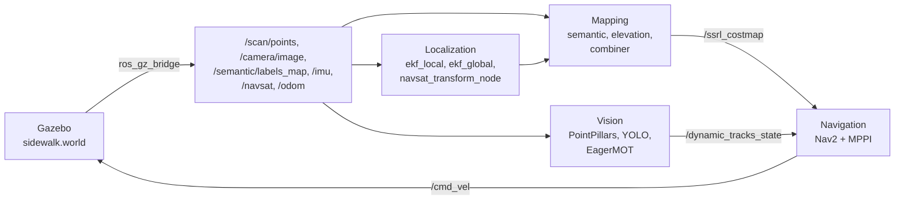

# Urban Outdoor Navigation: Gazebo simulation

Autonomous sidewalk navigation for a small delivery robot, developed for a Master's thesis in Robotics Engineering at the University of Genoa, in collaboration with the University of Minnesota. This `simulation` branch runs the system in Gazebo, on a simulated sidewalk with people walking on it. The real robot, a Clearpath Husky A100, is on the [`master`](https://github.com/AlessandroMangili/urban_outdoor_navigation) branch.

The simulation is where the system was first built and tested, with a simulated robot, ideal sensors and a GPS. The README of `master` explains how the semantic map, the elevation map, the confinement cost and the SpatioTemporalCritic work. This README covers what is specific to the simulation: what it contains, how to install it and how to run it.

## Contents

1. [Overview](#overview)
2. [Differences from the real robot](#differences-from-the-real-robot)
3. [World and robot](#world-and-robot)
4. [Installation](#installation)
5. [Running the simulation](#running-the-simulation)
6. [Launch arguments](#launch-arguments)
7. [Nodes and topics](#nodes-and-topics)
8. [Configuration](#configuration)
9. [Saving and loading the maps](#saving-and-loading-the-maps)
10. [Repository layout](#repository-layout)
11. [Known limitations](#known-limitations)

## Overview



The system has the same four blocks as on the real robot:

- **Localization:** two extended Kalman filters from `robot_localization`. The local one fuses wheel odometry and IMU; the global one adds the GPS through `navsat_transform_node`.
- **Mapping:** a semantic map and an elevation map of the ground, built while the robot drives and fused with a confinement cost into one costmap, `/ssrl_costmap`.
- **Vision:** people are detected in the LiDAR cloud with PointPillars and in the camera image with YOLO, and tracked with EagerMOT.
- **Navigation:** Nav2 plans on `/ssrl_costmap`, and MPPI follows the plan. The SpatioTemporalCritic of MPPI keeps the robot away from where the tracked people will be.

## Differences from the real robot

| | Simulation (this branch) | Real robot (`master`) |
|---|---|---|
| Robot | TurtleBot3 Waffle Pi model, differential drive, radius 0.22 m | Clearpath Husky A100, skid steer, 0.86 × 0.62 m |
| LiDAR | Gazebo `gpu_lidar`, 720 × 128 rays, 10 Hz, −25° to +15°, 10 m | Velodyne VLP-16 |
| Localization | wheel odometry, IMU and GPS fused by two EKFs | FAST-LIO and a localizer on a prior LiDAR map |
| Segmentation | ground truth from the Gazebo segmentation camera | segmentation network on the camera image |
| People detection | PointPillars (OpenPCDet) on the LiDAR, YOLOv8n on the camera | LiDAR clusters, YOLO26n on the camera |
| Tracking | EagerMOT, package `obstacles_tracking` | `tracker_3d` |
| MPPI critics | SpatioTemporalCritic | SpatioTemporalCritic and DetourCritic |
| Maps | built during the run, or loaded from a previous run | prior maps of the campus, frozen or updated live |

## World and robot

`simulation/worlds/sidewalk.world` is a street with a sidewalk, a curb, a grass strip, trees, lamps, a bench, trash bins, planters, buildings on both sides and a patch of grass on the sidewalk. Seven people move along scripted paths: five walk along the sidewalk, one crosses it at x = 5 m and one stands still at (8.5, 1.6). The geographic origin of the world, `47.478950, 19.057785`, is also the GPS datum of `navsat_transform_node`, so the `map` frame is the same wherever the robot is spawned.

Every model in the world carries a label of the Gazebo `Label` system, equal to its Cityscapes class ID plus one. The segmentation camera renders these labels, and `gt_segmentation_node` converts them back to Cityscapes IDs, so the semantic map receives a perfect segmentation.

The robot is a TurtleBot3 Waffle Pi model (`simulation/urdf`) with these sensors:

| Sensor | Gazebo type | Rate | Topics |
|---|---|---|---|
| 3D LiDAR | `gpu_lidar`, 720 × 128 rays, −25° to +15°, range 10 m | 10 Hz | `/scan/points`, `/scan` |
| RGB-D camera | `rgbd_camera`, 320 × 240, horizontal field of view 1.25 rad | 20 Hz | `/camera/image`, `/camera/camera_info` |
| Segmentation camera | `segmentation`, same lens as the camera | 20 Hz | `/semantic/labels_map` |
| IMU | `imu` | 200 Hz | `/imu` |
| GPS | `navsat` | 10 Hz | `/navsat` |
| Wheels | diff drive and joint state publisher | | `/odom`, `/joint_states`, `/cmd_vel` |

## Installation

The steps below are for Ubuntu 22.04 with ROS 2 Humble.

### Dependencies

| Software | Version |
|---|---|
| Ubuntu | 22.04 |
| ROS 2 | Humble |
| Gazebo | Fortress (Ignition Gazebo 6), with `ros_gz` for Humble |
| Nav2, including `nav2_mppi_controller` | Humble packages |
| `robot_localization` | Humble package |
| `tf2_ros_py` | 0.25.23 or newer |
| PyTorch and Ultralytics | YOLOv8n is downloaded on the first run |
| NumPy | 1.x: ROS 2 Humble needs NumPy 1 |
| OpenCV | Ubuntu 22.04 package |
| [OpenPCDet](https://github.com/open-mmlab/OpenPCDet) | only for PointPillars; needs an NVIDIA GPU with CUDA |

### System packages

```bash
sudo apt update && sudo apt upgrade
sudo apt install ros-humble-desktop ros-humble-navigation2 ros-humble-nav2-bringup \
  ros-humble-robot-localization ros-humble-ros-gz ros-humble-xacro \
  ros-humble-vision-msgs ros-humble-cv-bridge ros-humble-tf2-ros-py \
  python3-colcon-common-extensions python3-rosdep python3-pip python3-opencv git
```

> **Keep `ros-humble-tf2-ros-py` up to date.** The map nodes create their TF listener without a node. This works with version 0.25.23 and fails with 0.25.20 (`'NoneType' object has no attribute 'create_subscription'`).

Install PyTorch from pytorch.org, then:

```bash
pip install ultralytics "numpy<2"
pip install "setuptools<70"
```

The second line matters with recent PyTorch releases, which install `setuptools` 77 or later. That version breaks `colcon build` on Humble for every package with Python code (`canonicalize_version() got an unexpected keyword argument 'strip_trailing_zero'`). PyTorch keeps working with the older `setuptools`; pip only prints a warning.

### Workspace

```bash
mkdir -p ~/ros2_ws/src && cd ~/ros2_ws/src
git clone -b simulation https://github.com/AlessandroMangili/urban_outdoor_navigation.git

cd ~/ros2_ws
source /opt/ros/humble/setup.bash
rosdep install --from-paths src --ignore-src -r -y
colcon build --symlink-install
source install/setup.bash
```

The simulation launch file adds the install folder of the workspace to `GZ_SIM_RESOURCE_PATH`, so Gazebo finds the meshes of the world and of the robot.

### PointPillars

PointPillars runs in its own Python virtual environment with PyTorch and OpenPCDet, and needs an NVIDIA GPU with CUDA.

```bash
python3 -m venv --system-site-packages ~/pcdet_venv
source ~/pcdet_venv/bin/activate
pip install torch torchvision          # the CUDA build that matches your driver
pip install spconv-cu118               # the spconv build that matches your CUDA version
git clone https://github.com/open-mmlab/OpenPCDet.git ~/OpenPCDet
cd ~/OpenPCDet && pip install -r requirements.txt && python setup.py develop
```

`--system-site-packages` lets the virtual environment see the ROS 2 Python packages.

The model configuration and the trained checkpoint are not in this repository. Put the configuration under the `tools` folder of OpenPCDet, and set these parameters of `pointpillars_detector` in `obstacles_tracking/config/obstacles_tracking.yaml`:

| Parameter | Meaning |
|---|---|
| `cfg_dir` | the `tools` folder of OpenPCDet |
| `cfg_file` | the model configuration, relative to `cfg_dir` |
| `ckpt` | the PointPillars checkpoint |

Without PointPillars the tracker still starts, but it receives no 3D detections and publishes no tracks, so MPPI drives without the SpatioTemporalCritic.

## Running the simulation

Open one terminal per step. In each terminal:

```bash
source /opt/ros/humble/setup.bash
source ~/ros2_ws/install/setup.bash
```

### Step 1: Gazebo, robot and bridge

```bash
ros2 launch simulation start_simulation.launch.py
```

This starts Gazebo with `sidewalk.world`, spawns the robot at the origin, starts the bridge between Gazebo and ROS 2 and the robot state publisher, and opens RViz with `navigation_gps.rviz`. Add `headless:=true` to run Gazebo without its window.

### Step 2: localization

```bash
ros2 launch localization start_localization.launch.py
```

`ekf_local` publishes `/odometry/local` and the transform `odom -> base_footprint`. `ekf_global` publishes `/odometry/global` and `map -> odom`. `navsat_transform_node` waits 3 s for odometry and IMU, then converts the GPS fixes into `/odometry/gps`.

### Step 3: maps

```bash
ros2 launch semantic start_mapping.launch.py
```

This starts the ground-truth segmentation, the semantic map, the elevation map and the combiner that publishes `/ssrl_costmap`. The map nodes write only while the global position is certain. The global EKF starts with a large uncertainty, so the maps start a few seconds later, once the GPS has moved the filter to the real position. Add `overlay:=true` to see the segmentation on the camera image in RViz.

### Step 4: people tracking

```bash
ros2 launch obstacles_tracking obstacles_tracking.launch.py pcdet_python:=$HOME/pcdet_venv/bin/python3
```

`pcdet_python` is the interpreter of the virtual environment of [PointPillars](#pointpillars). To see the PointPillars messages in their own terminal, start the launch with `launch_pointpillars:=false` and run the detector by hand in another terminal, with the virtual environment active:

```bash
python3 -m obstacles_tracking.pointpillars_detector --ros-args \
  --params-file ~/ros2_ws/install/obstacles_tracking/share/obstacles_tracking/config/obstacles_tracking.yaml \
  -p use_sim_time:=true
```

### Step 5: navigation

```bash
ros2 launch navigation start_navigation.launch.py
```

This starts Nav2 with `navigation/config/navigation.yaml`. Send a goal with the **2D Goal Pose** tool of RViz, or from a terminal:

```bash
ros2 action send_goal /navigate_to_pose nav2_msgs/action/NavigateToPose \
  "{pose: {header: {frame_id: map}, pose: {position: {x: 6.0, y: 0.0}, orientation: {w: 1.0}}}}"
```

## Launch arguments

**`simulation start_simulation.launch.py`**

| Argument | Default | Meaning |
|---|---|---|
| `world` | `sidewalk.world` | world file in `simulation/worlds` |
| `model` | `turtlebot3_waffle_pi_gps.urdf` | robot description in `simulation/urdf` |
| `x`, `y`, `yaw` | `0` | spawn pose of the robot |
| `headless` | `false` | `true` starts Gazebo without its window |
| `rviz` | `true` | opens RViz |
| `rviz_config` | `navigation_gps.rviz` | RViz configuration in `simulation/rviz` |
| `use_sim_time` | `True` | use the Gazebo clock |

**`localization start_localization.launch.py`**

| Argument | Default | Meaning |
|---|---|---|
| `use_gps` | `True` | starts `navsat_transform_node`; with `false` the global EKF has no absolute position |
| `use_sim_time` | `True` | use the Gazebo clock |

**`semantic start_mapping.launch.py`**

| Argument | Default | Meaning |
|---|---|---|
| `overlay` | `false` | publishes `/semantic/overlay_rgb`, the camera image with the segmentation |

**`obstacles_tracking obstacles_tracking.launch.py`**

| Argument | Default | Meaning |
|---|---|---|
| `pcdet_python` | `python3` | Python interpreter of the PointPillars virtual environment |
| `launch_pointpillars` | `true` | `false` does not start PointPillars, so you can run it by hand |
| `config_file` | `obstacles_tracking.yaml` of the package | parameters of the three nodes |
| `use_sim_time` | `true` | use the Gazebo clock |

**`navigation start_navigation.launch.py`**

| Argument | Default | Meaning |
|---|---|---|
| `use_sim_time` | `True` | use the Gazebo clock |

## Nodes and topics

| Node | Package | Reads | Publishes |
|---|---|---|---|
| `parameter_bridge` | `ros_gz_bridge` | Gazebo topics, `/cmd_vel` | the sensor topics above and `/clock` |
| `ekf_local` | `robot_localization` | `/odom`, `/imu` | `/odometry/local`, `odom -> base_footprint` |
| `ekf_global` | `robot_localization` | `/odom`, `/imu`, `/odometry/gps` | `/odometry/global`, `map -> odom` |
| `navsat_transform_node` | `robot_localization` | `/navsat`, `/imu`, `/odometry/global` | `/odometry/gps` |
| `gt_segmentation_node` | `semantic` | `/semantic/labels_map` | `/semantic/segmentation` |
| `semantic_costmap_node` | `semantic` | `/scan/points`, `/semantic/segmentation`, `/camera/camera_info`, `/odometry/global` | `/semantic_costmap` |
| `elevation_costmap_node` | `semantic` | `/scan/points`, `/semantic/segmentation`, `/camera/camera_info`, `/odometry/global` | `/elevation_cost` |
| `ssrl_combiner` | `semantic` | `/semantic_costmap`, `/elevation_cost` | `/ssrl_costmap`, `/confinement_cost` |
| `yolo_detect_node` | `obstacles_tracking` | `/camera/image` | `/yolo/detections` |
| `pointpillars_detector` | `obstacles_tracking` | `/scan/points` | `/detections3d`, `/detections/markers` |
| `eagermot_tracker_node` | `obstacles_tracking` | `/detections3d`, `/yolo/detections`, `/camera/camera_info` | `/dynamic_tracks_state`, `/tracks/markers` |
| Nav2 | `nav2_bringup`, `navigation` | `/ssrl_costmap`, `/scan/points`, `/dynamic_tracks_state` | `/cmd_vel`, `/plan` |

The tracker fuses the two detectors as in EagerMOT (Kim, Osep and Leal-Taixé, ICRA 2021). A 3D box and a 2D box are paired when the projection of the 3D box overlaps the 2D box. The first stage matches the tracks with the 3D detections, the second stage matches the remaining tracks with the 2D detections. A track is published when the camera has confirmed it, or when the LiDAR alone has updated it at least `min_hits_3d` times: a person beside the robot is outside the field of view of the camera.

In Nav2 the local costmap is the fused map (`dynamic_costmap_layer/SemanticLayer`), the obstacles seen by the LiDAR and an inflation layer. The global costmap reads `/ssrl_costmap` with a static layer. The planner is the 2D Smac planner, and the controller is MPPI with an 8 s horizon and the SpatioTemporalCritic. The README of `master` explains the [maps](https://github.com/AlessandroMangili/urban_outdoor_navigation#mapping) and the [critic](https://github.com/AlessandroMangili/urban_outdoor_navigation#mppi-and-the-custom-critics).

## Configuration

| File | Contents |
|---|---|
| `localization/config/localization.yaml` | the two EKFs and `navsat_transform_node`, with the GPS datum |
| `semantic/config/semantic.yaml` | segmentation relay, semantic map, elevation map and combiner |
| `obstacles_tracking/config/obstacles_tracking.yaml` | YOLO, PointPillars and the EagerMOT tracker |
| `navigation/config/navigation.yaml` | Nav2: controller, MPPI critics, costmaps, planner, behaviors |
| `simulation/urdf/turtlebot3_waffle_pi_gps.gazebo` | sensors and plugins of the simulated robot |

Every parameter in the YAML files has a short comment. The ones you are most likely to change:

| Parameter | File | Default | Effect |
|---|---|---|---|
| `map_save_name`, `map_load_name` | `semantic.yaml` | `map1` and `elevation1` | names of the saved and loaded maps; empty means do not save, or start empty |
| `autosave` | `semantic.yaml` | `false` | saves the maps when the node shuts down |
| `cfg_dir`, `cfg_file`, `ckpt` | `obstacles_tracking.yaml` | paths on the author's computer | OpenPCDet folder, model configuration and checkpoint |
| `device` | `obstacles_tracking.yaml` | `cpu` | device of YOLO, `cuda:0` for the GPU |
| `vx_max` | `navigation.yaml` | `0.30` | highest forward speed [m/s] |
| `collision_radius` | `navigation.yaml` | `0.72` | base radius around a person in the SpatioTemporalCritic [m] |

## Saving and loading the maps

The semantic map and the elevation map start from the files named in `map_load_name`, or empty if those files do not exist. To save them during a run:

```bash
ros2 service call /semantic_costmap_node/save_map std_srvs/srv/Trigger
ros2 service call /elevation_costmap_node/save_map std_srvs/srv/Trigger
```

The maps are saved as `.npz` files in the `maps` folder of the `semantic` package in the source tree, which the nodes find through the `--symlink-install` links. If the source tree cannot be found, they use `share/semantic/maps` in the install folder, and if that cannot be written, `~/.semantic_maps`. The `maps` folders are listed in `.gitignore`.

## Repository layout

| Path | Contents |
|---|---|
| `simulation` | world, robot description, meshes, RViz configuration and the Gazebo launch file |
| `localization` | configuration and launch file of the EKFs and of `navsat_transform_node` |
| `semantic` | segmentation relay, semantic map, elevation map, combiner and overlay |
| `obstacles_tracking` | YOLO and PointPillars detectors, EagerMOT tracker |
| `dynamic_tracker_msgs` | messages of the tracked people |
| `spatiotemporal_critic` | the SpatioTemporalCritic plugin of MPPI |
| `dynamic_costmap_layer` | the costmap layer that injects `/ssrl_costmap` into the local costmap |
| `navigation` | Nav2 configuration and launch file |

## Known limitations

- **PointPillars needs CUDA and a trained checkpoint**, and the checkpoint is not in the repository. Without it there are no tracks, and the robot avoids people only through the local costmap.
- **The localization relies on the GPS.** The simulated GPS has no multipath and no outages, unlike the GPS on the campus, which is why the real robot uses a LiDAR map instead.
- **The segmentation is ground truth.** The semantic map never sees the errors of a real segmentation network.
- **Every Python node receives the full-rate simulated clock.** Gazebo publishes `/clock` at every physics step, and each message wakes up the executor of every Python node that uses `use_sim_time`. On a laptop, an idle Python node takes about 47 % of a core with `/clock` at 870 Hz, against 18 % at 100 Hz, so on a slow machine Gazebo runs below real time.

## License

MIT, see [LICENSE](LICENSE).
