# Urban Outdoor Navigation: Clearpath Husky A100

Autonomous sidewalk navigation for a small delivery robot, developed for a Master's thesis in Robotics Engineering at the University of Genoa, in collaboration with the University of Minnesota. All the experiments were run at the Shepherd Lab of the University of Minnesota, on the sidewalks of the East Bank campus. This `master` branch runs on the real Clearpath Husky A100. The Gazebo simulation is on the [`simulation`](https://github.com/AlessandroMangili/urban_outdoor_navigation/tree/simulation) branch.

<p align="center">
  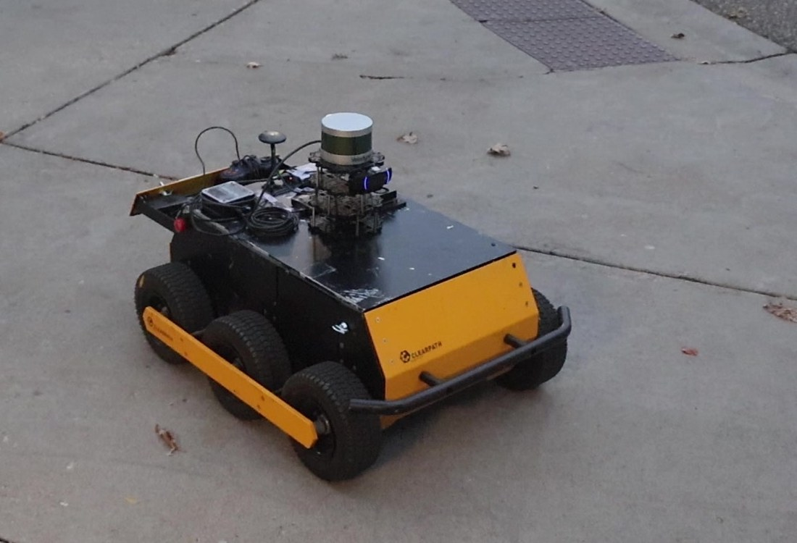
</p>

The robot localizes on a LiDAR map built beforehand, reads the ground with its camera and LiDAR, tracks the people around it and drives with Nav2 and MPPI. Everything runs on ROS 2 Humble on an NVIDIA Jetson Orin Nano, while a Raspberry Pi 5 runs the Clearpath driver of the base.

This README explains how the system is built, how to install and run it, and which parameters matter when you move it to another area. The design choices and the experiments are discussed in the thesis.

> [!WARNING]
> **An NVIDIA GPU with CUDA is required.** The segmentation network and the people detector run on the GPU (`device: cuda:0`). The robot used the GPU of the Jetson Orin Nano.

## Contents

**Set up**

1. [Overview](#overview)
2. [Robot](#robot)
    - [Hardware and connections](#hardware-and-connections)
    - [Sensor placement](#sensor-placement)
    - [Sensor topics](#sensor-topics)
3. [Installation](#installation)
    - [Dependencies](#dependencies)
    - [System packages](#system-packages)
    - [Workspace](#workspace)
    - [Patches to external packages](#patches-to-external-packages)
    - [MAVROS](#mavros)
    - [Files not in the repository](#files-not-in-the-repository)
    - [Environment and Raspberry Pi](#environment-and-raspberry-pi)
4. [Running the robot](#running-the-robot)
    - [Step 1: sensors and robot model](#step-1-sensors-and-robot-model)
    - [Step 2: localization](#step-2-localization)
    - [Step 3: maps](#step-3-maps)
    - [Step 4: navigation](#step-4-navigation)
    - [Step 5: vision](#step-5-vision)
    - [Step 6: RViz and goals](#step-6-rviz-and-goals)

**How it works**

5. [Localization](#localization)
    - [How the localization works](#how-the-localization-works)
    - [Using it on the robot](#using-it-on-the-robot)
    - [Building the prior map](#building-the-prior-map)
    - [Localization parameters](#localization-parameters)
6. [Mapping](#mapping)
    - [Semantic map](#semantic-map)
    - [Elevation map](#elevation-map)
    - [Fusion and confinement](#fusion-and-confinement)
    - [Building the ground maps](#building-the-ground-maps)
    - [Mapping parameters](#mapping-parameters)
7. [Vision](#vision)
    - [2D detection](#2d-detection)
    - [3D detection](#3d-detection)
    - [Tracking](#tracking)
    - [Vision parameters](#vision-parameters)
8. [Navigation](#navigation)
    - [Costmaps](#costmaps)
    - [MPPI and the custom critics](#mppi-and-the-custom-critics)
    - [Behavior tree and recoveries](#behavior-tree-and-recoveries)
    - [Navigation parameters](#navigation-parameters)

**Reference**

9. [Repository layout](#repository-layout)
10. [Known limitations](#known-limitations)
11. [Demo](#demo)

## Overview

<p align="center">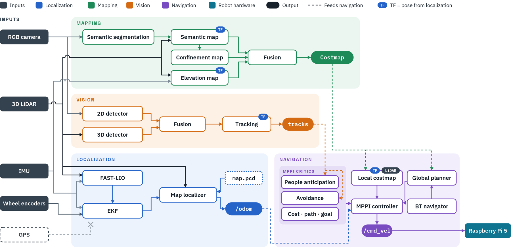</p>

The stack has five blocks, and each one has its own section below:

- **[Robot](#robot):** the Husky base, the sensors and the two computers.
- **[Localization](#localization):** where the robot is on a prior LiDAR map.
- **[Mapping](#mapping):** what the ground looks like, as one costmap built from a semantic map and an elevation map.
- **[Vision](#vision):** where the people around the robot are and how they move.
- **[Navigation](#navigation):** Nav2 plans on the costmap, and MPPI follows the plan while it avoids people and obstacles.

## Robot

### Hardware and connections

| Component | Model | Connected to | Cable |
|---|---|---|---|
| Mobile base | Clearpath Husky A100, 6 wheels, skid steer | Raspberry Pi 5 | USB-to-serial |
| 3D LiDAR | Velodyne VLP-16, 16 channels | Jetson | Ethernet |
| Camera | Logitech C920, used at 640 x 480 and 30 Hz | Jetson | USB |
| IMU and GPS | Pixhawk 1 running ArduCopter, with a u-blox M8 GPS (no RTK) | Jetson | USB |
| Main computer | NVIDIA Jetson Orin Nano Developer Kit, 8 GB | Raspberry Pi 5 | Ethernet |
| Platform computer | Raspberry Pi 5 | Husky base and Jetson | See the rows above |
| Joystick | Logitech F310 | Raspberry Pi 5 | USB |

The Jetson, the Pi and the LiDAR run on external batteries. The Husky batteries only power the base.

The Jetson runs everything in this repository. The Pi runs the Clearpath driver in Docker and receives the velocity commands from the Jetson over Ethernet. The joystick on the Pi always has priority over Nav2.

### Sensor placement

<p align="center">
  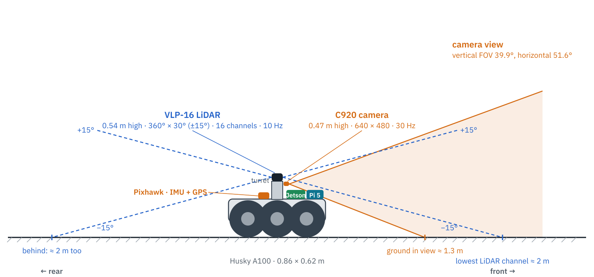
</p>
<p align="center">
  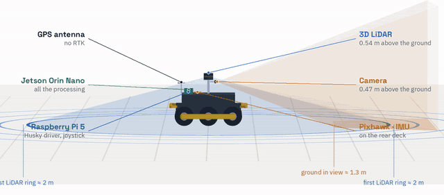
</p>

The LiDAR sits on a turret in the middle of the top plate, so that the body does not hide the ground around the robot. The camera is fixed under the LiDAR and looks forward. The Pixhawk is on the rear deck, aligned with the robot axes.

| Frame | Parent | Position [m] | Notes |
|---|---|---|---|
| `base_footprint` | | | On the ground, under the center of the robot |
| `top_chassis_link` | `base_link` | z = 0.34 above the ground | Center of the top plate |
| `velodyne` | `top_chassis_link` | (0, 0, 0.195) | Origin of `/velodyne_points`, 0.54 m above the ground |
| `c920_link` | `velodyne` | (0.08, 0, -0.06), small rotation | From the camera-LiDAR calibration |
| `c920_optical` | `c920_link` | | Optical frame of `/c920/image_raw` |
| `imu_link` | `top_chassis_link` | (-0.12, 0, 0.01) | Pixhawk; MAVROS stamps the IMU in `base_link` |

All the poses are in `husky_a100_description/urdf/sensors.urdf.xacro`, and the body dimensions are in `husky_a100_description/config/a100_dimensions.yaml`. Nav2 builds its footprint from these dimensions with a 2 cm margin. If you move a sensor, also update the two places that repeat its pose:

- `extrinsic_T` in `localization/config/fast_lio_vlp16.yaml`: LiDAR position relative to the IMU.
- The `odom -> camera_init` transform in `localization/launch/start_localization.launch.py`: IMU position relative to `base_footprint`.

### Sensor topics

**Velodyne VLP-16**

<table>
<tr><th width="272">Topic</th><th width="231">Type</th><th width="55">Rate</th><th width="162">Used by</th></tr>
<tr><td><code>/velodyne_points</code></td><td><code>sensor_msgs/PointCloud2</code></td><td nowrap>10&nbsp;Hz</td><td>FAST-LIO, map localizer, semantic map, elevation map, 3D detector, local costmap</td></tr>
</table>

**Logitech C920**

<table>
<tr><th width="272">Topic</th><th width="231">Type</th><th width="55">Rate</th><th width="162">Used by</th></tr>
<tr><td><code>/c920/image_raw</code></td><td><code>sensor_msgs/Image</code>, rgb8, 640 x 480</td><td nowrap>30&nbsp;Hz</td><td>Semantic segmentation, 2D detector</td></tr>
<tr><td><code>/c920/camera_info</code></td><td><code>sensor_msgs/CameraInfo</code></td><td nowrap>30&nbsp;Hz</td><td>Semantic map, 3D detector, tracker</td></tr>
<tr><td><code>/c920/image_raw/compressed</code></td><td><code>sensor_msgs/CompressedImage</code></td><td nowrap>30&nbsp;Hz</td><td>RViz and recordings</td></tr>
</table>

**Pixhawk**

<table>
<tr><th width="272">Topic</th><th width="231">Type</th><th width="55">Rate</th><th width="162">Used by</th></tr>
<tr><td><code>/mavros/imu/data</code></td><td><code>sensor_msgs/Imu</code></td><td nowrap>50&nbsp;Hz</td><td>FAST-LIO, EKF, elevation map, EKF of the Pi</td></tr>
<tr><td><code>/mavros/global_position/raw/fix</code></td><td><code>sensor_msgs/NavSatFix</code></td><td nowrap>5&nbsp;Hz</td><td></td></tr>
</table>

**Husky base**, published by the Clearpath driver on the Pi under `/a200_0000`:

<table>
<tr><th width="272">Topic</th><th width="231">Type</th><th width="55">In/Out</th><th width="162">Used by</th></tr>
<tr><td><code>/a200_0000/platform/odom</code></td><td><code>nav_msgs/Odometry</code></td><td nowrap>Out</td><td>EKF, for the wheel velocity</td></tr>
<tr><td><code>/a200_0000/platform/joint_states</code></td><td><code>sensor_msgs/JointState</code></td><td nowrap>Out</td><td>robot_state_publisher</td></tr>
<tr><td><code>/a200_0000/cmd_vel</code></td><td><code>geometry_msgs/TwistStamped</code></td><td nowrap>In</td><td>Written by <code>cmd_vel_bridge</code>, at the end of Nav2</td></tr>
</table>

ArduPilot sends no IMU data until someone asks for a stream rate: `sensors.launch.py` calls `/mavros/set_stream_rate` 8 s and 20 s after MAVROS starts.

## Installation

The steps below are for the Jetson (Ubuntu 22.04, ROS 2 Humble). They also work on an x86 computer with Ubuntu 22.04 and an NVIDIA GPU.

### Dependencies

| Software | Version |
|---|---|
| Ubuntu on the Jetson | 22.04, JetPack 6 (L4T R36.5) |
| ROS 2 | Humble |
| Nav2, including `nav2_mppi_controller` | 1.1.20 |
| `robot_localization` | 3.5.4 |
| `velodyne` driver | 2.5.1 |
| `v4l2_camera` | 0.6.2 |
| `tf2_ros_py` | 0.25.23 or newer |
| MAVROS | 2.16.0 from apt (the robot ran 2.15.1) |
| [FAST-LIO](https://github.com/hku-mars/FAST_LIO/tree/ROS2) | `ROS2` branch, commit `a4743b0`, plus [patch](#patches-to-external-packages) |
| [lidar_localization_ros2](https://github.com/rsasaki0109/lidar_localization_ros2) | v1.3.0, commit `3878a7a`, plus [patch](#patches-to-external-packages) |
| [ndt_omp_ros2](https://github.com/rsasaki0109/ndt_omp_ros2) | `humble` branch, commit `63bf15b` |
| [lidar_slam_ros2](https://github.com/rsasaki0109/lidar_slam_ros2) | `develop` branch, commit `e5bfe5f7`, only to build the prior map |
| PyTorch | 2.8.0 with CUDA |
| Ultralytics | 8.4.153 |
| NumPy | 1.26.4: ROS 2 Humble needs NumPy 1 |
| SciPy, OpenCV | Ubuntu 22.04 packages |
| Segmentation model | Any semantic segmentation model that Ultralytics can load and that gives every pixel one of the 19 Cityscapes classes |
| Detection model | YOLO26n trained on COCO, included as `dynamic_layer/models/detection.pt` |
| Raspberry Pi | Ubuntu 24.04, Docker, ROS 2 Jazzy, [Simplified-Clearpath-Husky](https://github.com/umn-cse-mnri/Simplified-Clearpath-Husky) |

### System packages

```bash
sudo apt install ros-humble-desktop ros-humble-navigation2 ros-humble-nav2-bringup \
  ros-humble-robot-localization ros-humble-pcl-ros ros-humble-velodyne ros-humble-xacro \
  ros-humble-v4l2-camera ros-humble-vision-msgs ros-humble-image-transport-plugins \
  ros-humble-camera-calibration ros-humble-mavros geographiclib-tools \
  python3-colcon-common-extensions python3-pip python3-scipy v4l-utils git
```

Install PyTorch with CUDA first: on the Jetson use the NVIDIA wheel for your JetPack, on x86 the wheel from pytorch.org. Then:

```bash
pip install ultralytics==8.4.153 numpy==1.26.4
pip install "setuptools<70"
```

The second line matters with recent PyTorch releases: 2.14 installs `setuptools` 77 or later, while 2.8, the version on the robot, does not. That version breaks `colcon build` on Humble for every package with Python code (`canonicalize_version() got an unexpected keyword argument 'strip_trailing_zero'`). PyTorch keeps working with the older `setuptools`; pip only prints a warning.

> **Keep `ros-humble-tf2-ros-py` up to date.** The map nodes create their TF listener without a node. This works with version 0.25.23 and fails with 0.25.20 (`'NoneType' object has no attribute 'create_subscription'`).

### Workspace

```bash
mkdir -p ~/ros2_ws/src && cd ~/ros2_ws/src
git clone https://github.com/AlessandroMangili/urban_outdoor_navigation.git

git clone -b ROS2 https://github.com/hku-mars/FAST_LIO.git
git -C FAST_LIO checkout a4743b0
git -C FAST_LIO submodule update --init --recursive
git -C FAST_LIO apply ../urban_outdoor_navigation/patches/FAST_LIO_ROS2_a4743b0.patch

git clone https://github.com/rsasaki0109/lidar_localization_ros2.git
git -C lidar_localization_ros2 checkout 3878a7a
git -C lidar_localization_ros2 apply ../urban_outdoor_navigation/patches/lidar_localization_ros2_v1.3.0_3878a7a.patch

git clone -b humble https://github.com/rsasaki0109/ndt_omp_ros2.git
git -C ndt_omp_ros2 checkout 63bf15b

cd ~/ros2_ws
source /opt/ros/humble/setup.bash
colcon build --symlink-install --cmake-args -DCMAKE_BUILD_TYPE=Release
```

With 8 GB of memory, as on the Jetson, build with `MAKEFLAGS=-j2 colcon build --parallel-workers 1 ...`. With more parallel jobs the compiler of `lidar_localization_ros2` runs out of memory and is killed.

FAST-LIO needs the message definitions of the Livox driver even with a Velodyne. `third_party/livox_ros_driver2` contains only those messages, so the whole Livox SDK is not needed.

### Patches to external packages

FAST-LIO and the map localizer needed small changes. Instead of keeping a fork, this repository pins the upstream commit and keeps the change as a `git diff` in `patches/`. `git apply` in the [Workspace](#workspace) step puts it back on that exact commit.

| Patch | Applied to | What it changes |
|---|---|---|
| `FAST_LIO_ROS2_a4743b0.patch` | FAST-LIO | Subscribes to the IMU with a best-effort QoS, the one MAVROS uses. Resets the velocity after a gap of more than 0.5 s in the IMU stream, instead of integrating a wrong acceleration. Skips invalid points. Adds the options `preprocess.ignore_point_time` and `publish.tf_publish_en`, so that the EKF can own the `odom` transform |
| `lidar_localization_ros2_v1.3.0_3878a7a.patch` | Map localizer | Publishes the start-up status, and stops the global search once the robot is localized, which frees CPU. Adds `map_odom_tf_future_s`, which post-dates `map -> odom` so that Nav2 does not wait for it |

To change an external package, edit it in the workspace and regenerate the patch from the package folder, for example `git -C FAST_LIO diff > urban_outdoor_navigation/patches/FAST_LIO_ROS2_a4743b0.patch`.

### MAVROS

MAVROS comes from apt, installed with the system packages above. It also needs the GeographicLib datasets, and your user must be allowed to open the Pixhawk serial port:

```bash
sudo /opt/ros/humble/lib/mavros/install_geographiclib_datasets.sh
sudo usermod -aG dialout $USER
```

Log out and in again after `usermod`. On the robot we ran MAVROS 2.15.1 built from source, because at the time the apt package was missing for arm64. Version 2.16.0 is now on apt for both arm64 and x86.

### Files not in the repository

The maps and the segmentation weights belong to our campus, so you have to make your own:

| File | Where it goes | How to get it |
|---|---|---|
| `semantic.pt` | `semantic/models/` | Weights of a semantic segmentation model that Ultralytics can load and that gives every pixel one of the 19 Cityscapes classes, trained or fine-tuned on images of your sidewalks |
| `map.pcd`, `grid.pgm`, `grid.yaml` | `localization/maps/` | See [Building the prior map](#building-the-prior-map) |
| `semantic_<name>.npz`, `elevation_<name>.npz` | `semantic/maps/` | Written by the mapping nodes, see [Building the ground maps](#building-the-ground-maps) |
| `camera_calibration.yaml` | `~/.ros/camera_info/` | Calibrate the camera at 640 x 480 with a checkerboard and `ros2 run camera_calibration cameracalibrator` |

`colcon build` copies `semantic/models` and `localization/maps` to the install folder, so build again after you add a file there. If `localization/maps` did not exist during the first build, add `--cmake-force-configure`:

```bash
colcon build --symlink-install --packages-select localization semantic --cmake-force-configure
```

The ground maps are the exception: the mapping nodes read and write them directly in `src/urban_outdoor_navigation/semantic/maps`.

### Environment and Raspberry Pi

Add these lines to `~/.bashrc`:

```bash
source /opt/ros/humble/setup.bash
source ~/ros2_ws/install/setup.bash
```

Network and devices:

| Link | Configuration |
|---|---|
| Jetson to LiDAR | Jetson `192.168.1.102/24`; the VLP-16 keeps its default `192.168.1.201` |
| Jetson to Pi | Jetson `192.168.131.2/24`, Pi `192.168.131.1/24`, same `ROS_DOMAIN_ID` (0) |
| C920 | `sensors.launch.py` opens the camera by its serial number (`C920_DEVICE`): replace it with the path of yours from `ls /dev/v4l/by-id/` |
| Pixhawk | `/dev/ttyACM0`, changeable with `fcu_url` |

The Pi runs [Simplified-Clearpath-Husky](https://github.com/umn-cse-mnri/Simplified-Clearpath-Husky) in the Docker container `husky-platform`, which publishes the robot under `/a200_0000`. Follow its README to install it. In its `robot.yaml` we set the controller to 10 Hz, configured the F310 joystick, and made the EKF of the Pi take the yaw rate from the Pixhawk (`/mavros/imu/data`), because the wheel odometry of a skid-steer robot is poor in rotation.

Power on the Husky before the Pi. If the Pi starts first, the driver does not find the serial port and the robot does not move. In that case, restart the container:

```bash
ssh ubuntu@192.168.131.1 docker restart husky-platform
```

## Running the robot

Open one terminal per step, in this order. Each launch file accepts the arguments in its table as `name:=value`.

### Step 1: sensors and robot model

```bash
ros2 launch husky_a100_description display.launch.py rviz:=false
```

| Argument | Default | Description |
|---|---|---|
| `sensors` | `true` | Starts the LiDAR, camera and Pixhawk drivers |
| `lidar`, `c920`, `imu` | `true` | Starts each driver on its own. A driver that is already running is not started twice |
| `fcu_url` | `/dev/ttyACM0:57600` | Serial port of the Pixhawk |
| `stream_rate` | `50` | IMU rate requested from the Pixhawk [Hz] |
| `rviz` | `true` | Opens RViz with `rviz_config` |
| `rviz_config` | `rviz/a100.rviz` | RViz configuration |
| `replay` | `false` | `true` when replaying a bag with `--clock`: simulated time and no drivers |
| `model`, `dimensions_file`, `urdf_extras` | Package files | Robot xacro, dimensions YAML and sensor xacro |

### Step 2: localization

```bash
ros2 launch localization start_localization.launch.py use_map_localization:=true start_mode:=global
```

| Argument | Default | Description |
|---|---|---|
| `use_map_localization` | `false` | `true` starts the map localizer, which publishes `map -> odom`. Navigation needs it |
| `start_mode` | `fixed` | `fixed` uses the pose given by `initial_*`. `global` reuses the last saved pose if it still matches the scan, otherwise it searches the whole map |
| `initial_x`, `initial_y`, `initial_yaw_deg` | `0` | Start pose on the map [m, m, degrees], used with `start_mode:=fixed` |
| `initial_z` | `-0.57` | Height of `base_footprint` in the map frame [m] |
| `map_path` | `localization/maps/map.pcd` | Prior point-cloud map |
| `occupancy_yaml` | `localization/maps/grid.yaml` | 2D grid used by the global search |
| `pose_state_path` | `~/.ros/localizer_pose.json` | File where the last pose is saved |
| `use_fastlio` | `true` | `false` does not start FAST-LIO, for bags that already contain `/Odometry` |
| `use_sim_time` | `false` | `true` when replaying a bag with `--clock` |

### Step 3: maps

```bash
ros2 launch semantic start_mapping.launch.py map_name:=<name> step_lethal_radius:=0.3
```

| Argument | Default | Description |
|---|---|---|
| `map_name` | empty | Sets `map_name` of the map nodes in `semantic/config/semantic.yaml`: it loads `semantic_<name>.npz` and `elevation_<name>.npz` from `semantic/maps` and saves them back on Ctrl-C. Empty starts from blank maps and saves nothing |
| `update_maps` | `true` | `false` freezes the maps: it publishes the loaded maps without segmentation or updates, which saves a lot of CPU |
| `model` | `semantic.pt` | Segmentation weights: a file name in `semantic/models`, or an absolute path |
| `step_lethal_radius` | `0.0` | Distance from a height jump within which the step is lethal [m]. `0` extends it up to 0.6 m past the curb. We use `0.3` |
| `semantic_ray_clearing` | `true` | Ray clearing of the semantic map: removes lethal cells that the LiDAR sees through close to the ground. The elevation map always clears its cells along the rays |
| `frame` | `map` | Frame of the maps. `odom` maps without the localizer |
| `cpu_cores` | `4,5` | CPU cores for the map nodes (`taskset`). On a bigger computer, give more cores, for example `0-7` |
| `replay` | `false` | `true` when replaying a bag with `--clock`: simulated time, decompressed images, segmentation overlay |

### Step 4: navigation

```bash
ros2 launch navigation start_navigation.launch.py clear_footprint:=true
```

| Argument | Default | Description |
|---|---|---|
| `clear_footprint` | `false` | `true` ignores the lethal cells of the stored map that lie under the robot's current footprint, so that an old obstacle saved in the map cannot trap the robot. We use `true` |
| `move_robot` | `true` | `false` does not forward the commands to the Pi, for tests on bags |
| `use_sim_time` | `false` | `true` when replaying a bag with `--clock` |

### Step 5: vision

```bash
ros2 launch dynamic_layer start_dynamic_navigation_layer.launch.py
```

| Argument | Default | Description |
|---|---|---|
| `model` | `detection.pt` | YOLO detection weights: a file name in `dynamic_layer/models`, or an absolute path |
| `use_sim_time` | `false` | `true` when replaying a bag with `--clock` |

### Step 6: RViz and goals

```bash
rviz2 -d $(ros2 pkg prefix --share husky_a100_description)/rviz/navigation.rviz
```

This configuration shows the maps, the plans, the detections and the tracks. Send a goal with the **Nav2 Goal** tool, or from a terminal, in map coordinates:

```bash
ros2 action send_goal /navigate_to_pose nav2_msgs/action/NavigateToPose \
  "{pose: {header: {frame_id: map}, pose: {position: {x: -40.0, y: -2.0}, orientation: {w: 1.0}}}}"
```

When you stop the map terminal, wait for the message that the maps were saved before you close it.

## Localization

### How the localization works

GPS is recorded but not used: on our campus its median error was about 10 m, and the sidewalks are 2 to 3 m wide. The robot localizes on a LiDAR map of the area instead, built beforehand. Three components work together:

| Component | Package | Input | Output |
|---|---|---|---|
| LiDAR-inertial odometry | FAST-LIO | `/velodyne_points`, `/mavros/imu/data` | `/Odometry`: smooth, but it drifts slowly |
| EKF | `robot_localization` | Wheel velocity, FAST-LIO, IMU yaw rate | `odom -> base_footprint` at 30 Hz, `/odometry/local` |
| Map localizer | `lidar_localization_ros2` with `ndt_omp_ros2` | `/velodyne_points`, prior map `map.pcd` | `/pcl_pose` and `map -> odom` |

The EKF gives a continuous pose that never jumps. The map localizer aligns each scan to the prior map with NDT, starting from the motion predicted by the EKF, and publishes the correction as `map -> odom`. A scan that does not fit the map well enough is rejected, and the last correction stays in place until a good scan arrives.

At start-up, with `start_mode:=global`, the localizer first tries the last pose it saved. If that pose does not match the current scan, it searches the whole map on the 2D grid `grid.yaml` and keeps the best candidate.

### Using it on the robot

- Start with the robot standing still. The global search takes 10 to 20 s. Check in RViz that the scan lies on the map before you send a goal.
- If the global search picks the wrong place, for example in a symmetric corridor, restart with `start_mode:=fixed` and give the pose with `initial_x`, `initial_y` and `initial_yaw_deg`.
- In the localizer log, the fitness score of each scan should stay well below `score_threshold`. A score that keeps growing means the area has changed since the map was built.
- After you power on the Pixhawk, let it warm up for about 10 minutes before you build a map: its gyroscope bias keeps changing until then.

### Building the prior map

1. **Record a bag.** Start [Step 1](#step-1-sensors-and-robot-model), then drive the area with the joystick while you record the LiDAR and the IMU:

   ```bash
   ros2 bag record -o map_bag /velodyne_points /mavros/imu/data /tf_static
   ```

2. **Run the SLAM with loop closure.** Build [lidar_slam_ros2](https://github.com/rsasaki0109/lidar_slam_ros2) in a separate workspace, following its README. It runs RKO-LIO as odometry and a pose graph that closes the loops. From its folder, with the parameters used for our map:

   ```bash
   ./scripts/lidarslam run ~/map_bag --profile rko_lio_graph_public_path --output-dir ~/map_out \
     --lidarslam-param ~/ros2_ws/src/urban_outdoor_navigation/localization/config/lidar_slam/lidarslam.yaml \
     --rko-param ~/ros2_ws/src/urban_outdoor_navigation/localization/config/lidar_slam/rko_lio.yaml \
     --base-frame base_footprint --lidar-frame velodyne --imu-frame base_link
   ```

3. **Install the map.** Copy the resulting point cloud to `localization/maps/map.pcd`.

4. **Make the 2D grid** for the global search:

   ```bash
   cd ~/ros2_ws/src/urban_outdoor_navigation
   ros2 run lidar_localization_ros2 generate_occupancy_map_from_pcd --pcd localization/maps/map.pcd \
     --output-dir localization/maps --map-name grid --max-obstacle-height-m 3.0
   ```

5. **Build again** with `--cmake-force-configure`, as in [Files not in the repository](#files-not-in-the-repository).

6. **Check `initial_z`:** it is the height of `base_footprint` in the map frame. Our map has its origin at the LiDAR, so the ground is at -0.57 m.

Tips for a good map:

- Drive slowly and steadily, at 0.5 m/s or less, and turn slowly.
- Close loops: come back to where you started and drive some stretches twice. Loop closure removes the drift only where the path meets itself.
- Drive each sidewalk in both directions, so that both sides are well covered.
- Map when the area is quiet. Parked cars and bikes become part of the map, and walking people leave traces.
- Walk away from the robot, or behind it, out of the LiDAR's view: otherwise you end up in the map.
- Look at the map from the side. The pose graph has no gravity constraint, so a long loop can bend in height.

### Localization parameters

| Parameter | File | Value | Effect |
|---|---|---|---|
| `score_threshold` | `localization/config/lidar_localization.yaml` | 6.0 | Worst NDT fitness that is still accepted. Lower is stricter |
| `ndt_resolution` | same | 1.0 m | NDT cell size. Larger is more robust to a poor start, smaller is more precise |
| `voxel_leaf_size` | same | 0.2 m | Scan downsampling. Larger uses less CPU, at some cost in precision |
| `scan_min_range` | same | 1.0 m | Ignores the points closer than this, which include the operator |
| `map_odom_tf_future_s` | same | 0.5 s | How far `map -> odom` is post-dated |
| `extrinsic_T` | `localization/config/fast_lio_vlp16.yaml` | `[0.12, 0, 0.185]` | LiDAR position relative to the IMU |
| `preprocess.blind` | same | 0.8 m | FAST-LIO ignores the points closer than this |
| `odom*_config`, `imu0_config` | `localization/config/localization.yaml` | See the file | Which signals the EKF fuses |

## Mapping

The robot keeps two maps of the ground, both in the `map` frame with 5 cm cells. They are built while driving, saved under a name, and fused into the single costmap `/ssrl_costmap` that Nav2 uses.

| Map | Node | Input | Output | What it captures |
|---|---|---|---|---|
| Semantic | `semantic_costmap_node` | Segmented image, LiDAR, pose | `/semantic_costmap` | What the ground is: sidewalk, grass, road, obstacle |
| Elevation | `elevation_costmap_node` | LiDAR, pose, IMU attitude | `/elevation_cost` | How the ground is shaped: slopes, steps, rough terrain |
| Fused | `ssrl_combiner` | The two maps | `/ssrl_costmap`, `/confinement_cost` | The cost used for planning |

### Semantic map

| 1. Camera frame | 2. Segmentation | 3. LiDAR points with their class | 4. Votes in the map cells |
|---|---|---|---|
| 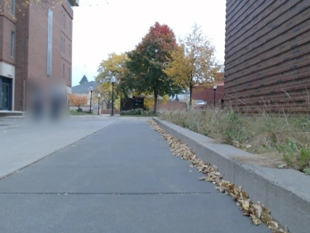 | 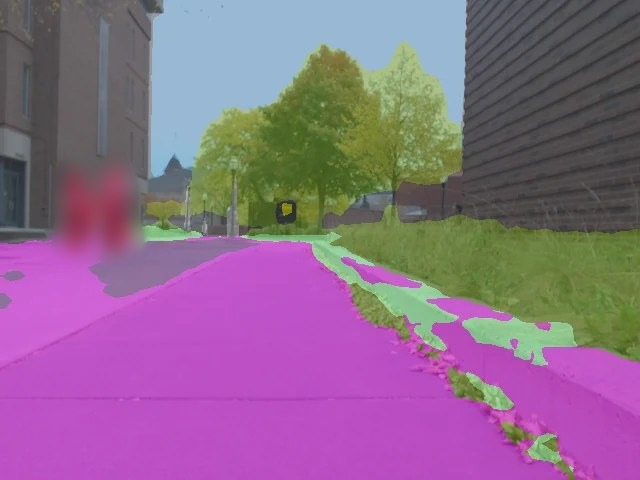 | 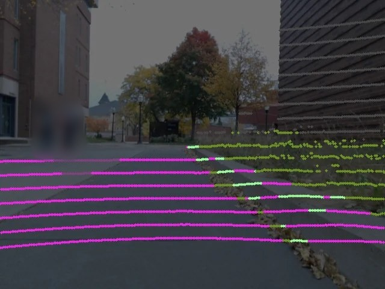 | 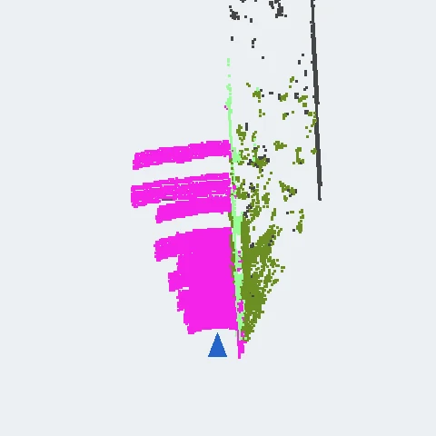 |

The segmentation network labels every camera pixel with one of the 19 Cityscapes classes. Each LiDAR point of the same instant is projected into the image and takes the class of its pixel: the LiDAR gives the position and the camera gives the class. This works only because the LiDAR and the camera were calibrated against each other (extrinsic calibration): their relative pose is in `sensors.urdf.xacro` (`velo_c920_xyz` and `velo_c920_rpy`), and a few centimetres of error would move the sidewalk edge onto the grass.

Each point then votes for its class in its map cell, with a weight that decreases with distance. A cell becomes known after `alpha_min` votes, and its votes are capped at `alpha_max`, so that a cell can still change its mind. If $\alpha_c$ is the vote of class $c$ in a cell and $k_c$ the cost of that class, the cost of the cell is

$$C = \frac{\sum_c \alpha_c\,k_c}{\sum_c \alpha_c}$$

and the cell becomes lethal when the obstacle classes hold at least `p_lethal` of the votes.

| Class | Cost |
|---|---|
| Sidewalk | 0 |
| Terrain (grass) | 70 |
| Road | 90 |
| Building, wall, fence, pole, traffic sign, vegetation | 100 (lethal) |
| Person, rider and vehicles | Never written in the map |

Points higher than 0.64 m are not written, so the robot can drive under benches and canopies. People and vehicles are left out of the map, with a margin around them, because they move.

### Elevation map

<p align="center">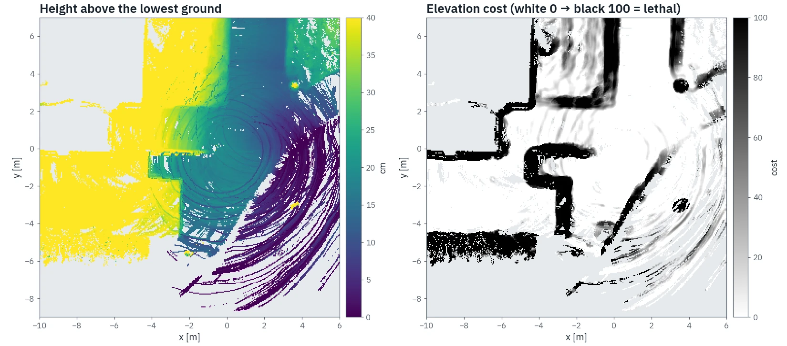</p>

The elevation map stores the height of the ground in each cell, measured by the LiDAR all around the robot, and turns it into a cost. On the left of the figure, the height above the lowest ground: the raised sidewalk is yellow and the road is dark blue. On the right, the cost read from those heights: white is flat ground, grey is a slope or rough ground, and black is a step the robot cannot climb, such as a curb. A step of 10 cm or more is lethal; a gentle ramp costs nothing.

### Fusion and confinement

`ssrl_combiner` fuses the two maps cell by cell. It starts from the semantic cost and adds the confinement cost, which keeps the robot in the middle of the sidewalk: without it, the cheapest path follows the sidewalk edge, right next to the grass or the road. The confinement exists only on sidewalk cells, is highest at the edge and fades towards the middle within about half a metre.

The elevation cost is then added on top, in the room left below the lethal cost, so a slope makes a sidewalk cell more expensive but never lethal. A lethal step stays lethal, the result is never cheaper than the semantic cost, and cells that the camera has never seen stay unknown.

### Building the ground maps

1. Start the [sensors](#step-1-sensors-and-robot-model) and the [localization](#step-2-localization).
2. Start the maps with a new name, `ros2 launch semantic start_mapping.launch.py map_name:=<name> step_lethal_radius:=0.3`, and drive the area with the joystick or with Nav2.
3. Stop with Ctrl-C: the maps are saved as `semantic/maps/semantic_<name>.npz` and `elevation_<name>.npz`. You can also save them at any time:

   ```bash
   ros2 service call /semantic_costmap_node/save_map std_srvs/srv/Trigger
   ros2 service call /elevation_costmap_node/save_map std_srvs/srv/Trigger
   ```

Tips:

- The camera sees the ground from about 1.3 m to 8 m ahead, and only in front. Drive every sidewalk you want to use, in both directions.
- Look at the maps in RViz before navigating: an area of grass labelled as sidewalk will be used as sidewalk.
- Never copy a `.tmp` file over a map: it is a write that was interrupted.

### Mapping parameters

All in `semantic/config/semantic.yaml`, where every parameter has a short description.

| Parameter | Node | Value | What it changes |
|---|---|---|---|
| `resolution` | semantic, elevation | 0.05 m | Cell size of both maps |
| `map_write_max_range` | semantic, elevation | 8 m | How far a scan writes the ground. Farther points are sparse and less precise |
| `max_obstacle_height` | semantic | 0.64 m | Higher points are not obstacles: the robot passes under them |
| `alpha_min`, `alpha_max` | semantic | 2, 10 | Votes before a cell is known, and the cap that keeps it able to change |
| `p_lethal` | semantic | 0.5 | Share of obstacle votes that makes a cell lethal |
| `dyn_dilate_px` | semantic | 6 px | Margin around people and vehicles in which nothing is written |
| `sensor_var_base`, `sensor_var_dist` | elevation | 0.0009, 0.0004 | Height noise of a point, and its growth with distance |
| `slope_dead`, `slope_crit` | elevation | 0.08, 0.35 | Slope with no cost and slope with full cost [m/m]: about 4.6° and 19° |
| `rough_dead`, `rough_crit` | elevation | 0.025, 0.06 m | The same for roughness |
| `step_dead`, `step_crit` | elevation | 0.04, 0.10 m | The same for steps |
| `step_lethal_m` | elevation | 0.10 m | Steps at least this high are lethal. Set it to what your robot cannot climb |
| `tilt_reject_deg` | elevation | 0.7° | Scans more tilted than this against the map are discarded |
| `imu_roll_offset_deg`, `imu_pitch_offset_deg` | elevation | 0.12°, -0.28° | Mounting tilt of the Pixhawk |
| `use_confinement` | combiner | `true` | Turns the confinement on or off |
| `sidewalk_cost_max` | combiner | 15 | Cells with a semantic cost up to this value count as sidewalk |
| `conf_max`, `falloff` | combiner | 40, 0.4 m | Confinement cost at the edge, and how fast it decays towards the middle |
| `w_elev` | combiner | 0.6 | Weight of the elevation cost |
| `soft_ceiling` | combiner | 97 | Highest cost that the elevation can add without making the cell lethal |

## Vision

Vision tells the navigation where the obstacles around the robot are and how they move. Three nodes work in a chain:

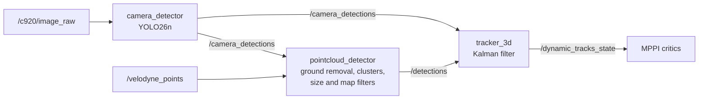

### 2D detection

`camera_detector` runs YOLO26n, trained on COCO, on the camera images, at up to 10 Hz. It keeps three classes: person, bicycle and motorcycle, with a confidence of at least 0.35. It publishes 2D boxes on `/camera_detections`. The boxes are not used on their own, because a box gives no distance: they help the 3D detector and the tracker decide what is a person.

### 3D detection

`pointcloud_detector` finds the objects in each LiDAR scan:

1. **Crop:** keeps the points between 0.3 and 12 m from the sensor.
2. **Downsample:** one point per 10 cm voxel.
3. **Ground removal:** fits the ground plane with RANSAC and removes it.
4. **Clustering:** groups the points closer than 0.30 m, then merges clusters closer than 0.45 m, such as the two legs of one person.
5. **Size filter:** keeps clusters between 0.2 and 2.2 m high and at most 1 m wide.
6. **Map filter:** drops a cluster farther than 3 m when at least half of its points lie within 0.2 m of the prior map `map.pcd`: walls, poles and trees are already there, a person is not.
7. **Camera rescue:** a cluster rejected by the filters is kept if it falls inside a YOLO box at a consistent depth. This recovers a person standing next to a wall, or a bicycle wider than 1 m.

The result is a list of 3D detections on `/detections`.

### Tracking

`tracker_3d` follows each detection over time in the `odom` frame, so that the robot's own motion does not look like motion of the people:

- **Kalman filter** with constant velocity: it estimates the position, the velocity and their uncertainty.
- **Association:** a new detection joins the track it is statistically closest to (Mahalanobis gate at 99%), with a distance limit of 1.5 m.
- **Life cycle:** a track is confirmed after 3 detections, and deleted after 10 frames without one.
- **Moving or still:** a track counts as moving when its speed stays above 0.3 m/s for 4 frames and is larger than its own uncertainty.
- **What is published:** a track that YOLO confirms as a person is always published, also when it stands still. Any other track is published only if it moves, is within 6 m, does not sit on a lethal cell of the semantic map, and is not seen by the camera as a wall, a pole or vegetation.

The tracks are published on `/dynamic_tracks_state` as `dynamic_tracker_msgs/TrackArray`, with position, velocity and uncertainty, and as markers on `/tracks/markers`. The [SpatioTemporalCritic](#mppi-and-the-custom-critics) uses the tracks faster than 0.4 m/s. The DetourCritic leaves alone the obstacles that belong to a moving track.

### Vision parameters

All in `dynamic_layer/config/dynamic_tracker.yaml`, where every parameter has a short description.

| Parameter | Node | Value | What it changes |
|---|---|---|---|
| `conf` | `camera_detector` | 0.35 | YOLO confidence threshold. Lower finds more people and more false ones |
| `classes` | `camera_detector` | `[0, 1, 3]` | COCO classes: person, bicycle, motorcycle |
| `min_range`, `max_range` | `pointcloud_detector` | 0.3, 12 m | LiDAR range used for detection |
| `voxel_size` | `pointcloud_detector` | 0.10 m | Downsampling. Larger uses less CPU, but small objects lose points |
| `cluster_tolerance`, `merge_dist` | `pointcloud_detector` | 0.30, 0.45 m | When points, then clusters, belong to the same object |
| `min_height`, `max_height`, `max_footprint` | `pointcloud_detector` | 0.2, 2.2, 1.0 m | Which clusters can be a person |
| `map_filter`, `map_filter_dist` | `pointcloud_detector` | `true`, 0.20 m | Drops clusters within this distance of the prior map |
| `map_filter_min_dist` | `pointcloud_detector` | 3 m | Clusters closer than this are never removed by the map filter |
| `camera_rescue` | `pointcloud_detector` | `true` | Recovers rejected clusters inside YOLO boxes |
| `accel_std`, `meas_std` | `tracker_3d` | 0.8, 0.10 | Kalman noise. Higher `accel_std` follows turns faster, but the velocity is noisier |
| `min_hits`, `max_age` | `tracker_3d` | 3, 10 | Detections to confirm a track, and missed frames to delete it |
| `min_speed`, `promote_frames` | `tracker_3d` | 0.3 m/s, 4 | When a track counts as moving |
| `lidar_publish_range` | `tracker_3d` | 6 m | Range within which tracks not confirmed by YOLO are published |

## Navigation

Navigation uses Nav2 1.1.20 with the MPPI controller. The velocity commands go through `cmd_vel_bridge`, which converts them to the `TwistStamped` that the Clearpath driver expects, limits them, and sends them to the Pi on `/a200_0000/cmd_vel`.

### Costmaps

| Costmap | Frame | Layers | Role |
|---|---|---|---|
| Global | `map` | Static layer on `/ssrl_costmap`, inflation | The planner (`SmacPlanner2D`) finds the path on the fused map about once per second |
| Local | `odom`, 8 x 8 m around the robot | LiDAR obstacle layer, `SemanticLayer` with `/ssrl_costmap`, inflation | MPPI checks every candidate trajectory against it |

The global costmap has no obstacle layer on purpose. People and temporary obstacles are handled locally, otherwise they would stay in the global plan as ghosts after they leave.

`SemanticLayer`, in `dynamic_costmap_layer`, injects the fused map into the local costmap. In every update it reads the cells of `/ssrl_costmap` under the local window and writes them into the costmap, scaling 0-100 to 0-254, with 100 as lethal. In the same costmap the LiDAR obstacle layer marks what is between 0.25 and 1 m high within 6 m. MPPI therefore sees both the ground from the maps and the obstacles that are not in any map.

### MPPI and the custom critics

MPPI samples 800 velocity sequences over 6 s (60 steps of 0.1 s), scores each one with a set of critics, and follows their weighted average. The robot drives at up to 0.30 m/s and turns at up to 0.25 rad/s. Besides the standard Nav2 critics (Constraint, Cost, Goal, GoalAngle, PathAlign, PathFollow, PathAngle and PreferForward), `mppi_critics` adds two critics:

**SpatioTemporalCritic** anticipates moving people. For every moving track it predicts where the person will be at the time of each trajectory point, with constant velocity, $p(t) = p_0 + v\,t$. Around that position it places a disc whose radius grows with the uncertainty of the track:

$$r(t) = \min\big(r_c + \sigma_p + g\,\sigma_v\,t,\ r_{\max}\big)$$

A trajectory point whose footprint enters the disc costs $1 - d/r$, where $d$ is the distance to the person. The first contact also adds a time-to-collision term $w_{\mathrm{ttc}}/(\tau + \varepsilon)$, where $\tau$ is when the contact happens. As a result, the robot slows down, waits or moves aside before the person arrives, not when they are already in front of it.

<p align="center">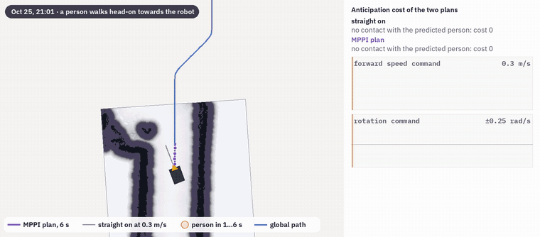</p>

**DetourCritic** handles still obstacles that block the path and are not in the maps, such as a person standing on a narrow sidewalk: people are never written into the maps, so the global path still goes through them. The 6 s horizon of MPPI alone does not let MPPI find the way around. The critic wakes up when the global path is blocked within 2 m and the robot makes no progress for 1.2 s, or gets too close to the obstacle. It then compares a route on each side of the obstacle with Dijkstra on the local costmap, keeping only gaps at least 0.8 m wide, and picks the cheaper one. It keeps that choice and pulls MPPI through waypoints along the route until the path is free again. Moving tracks are left to the SpatioTemporalCritic.

<p align="center">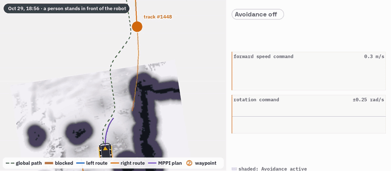</p>

### Behavior tree and recoveries

`navigation/config/bt_no_spin.xml` replans once per second. When the robot is stuck, it runs one recovery at a time, in rotation: clear the costmaps, wait 5 s, back up 0.30 m. The tree has no Spin: turning in place on a narrow sidewalk does not help.

The tree uses `ProgressRecoveryNode`, from `delivery_bt_nodes`, instead of the standard RecoveryNode. It allows 10 retries, and gives all of them back whenever the remaining path has become 1 m shorter. On a long route, several separate blockages therefore do not add up to a failure.

### Navigation parameters

All in `navigation/config/navigation.yaml`, where every parameter has a short description, except the launch arguments.

| Parameter | Value | What it changes |
|---|---|---|
| `vx_max`, `wz_max` | 0.30 m/s, 0.25 rad/s | Speed limits of MPPI |
| `batch_size` | 800 | MPPI samples. More samples find better trajectories, at a CPU cost |
| `time_steps`, `model_dt` | 60, 0.1 s | Horizon of 6 s |
| `CostCritic.cost_weight` | 25 | How strongly trajectories avoid cost, including the confinement |
| `inflation_radius`, `cost_scaling_factor` | 0.56 m, 10 | Safety margin around lethal cells |
| `SpatioTemporalCritic.prediction_horizon_s` | 6.0 s | How far ahead people are predicted |
| `SpatioTemporalCritic.collision_radius` | 0.35 m | Base radius $r_c$ around a person |
| `SpatioTemporalCritic.cost_weight`, `ttc_weight` | 20, 20 (defaults) | Weights of the closeness and time-to-collision terms |
| `DetourCritic.check_distance`, `stuck_time` | 2.0 m, 1.2 s | When the detour wakes up |
| `DetourCritic.min_gap`, `max_offset` | 0.8 m, 1.2 m | Narrowest gap accepted, and how far from the path a detour may go |
| `DetourCritic.cost_weight`, `pre_wp1_gain` | 5, 4 | Pull towards the waypoints, stronger before the first one |
| `obstacle_layer.min_obstacle_height`, `max_obstacle_height` | 0.25, 1.0 m | Which LiDAR points mark obstacles in the local costmap |
| `velocity_smoother.max_accel` | 0.4 m/s², 0.3 rad/s² | Accelerations sent to the robot |
| `cmd_vel_bridge.max_linear`, `max_angular` | 0.35 m/s, 0.35 rad/s | Last limit before the Pi |

## Repository layout

| Folder | Content |
|---|---|
| `husky_a100_description` | URDF of the A100 with its sensors, sensor drivers launch, RViz configurations |
| `localization` | EKF, FAST-LIO and map localizer configuration and launch; `config/lidar_slam` has the SLAM parameters for the prior map |
| `semantic` | Segmentation, semantic and elevation maps, map fusion |
| `dynamic_layer` | 2D detector, 3D detector and tracker |
| `dynamic_tracker_msgs` | Track messages |
| `dynamic_costmap_layer` | `SemanticLayer`, the costmap plugin that injects the fused map into the local costmap |
| `mppi_critics` | `SpatioTemporalCritic` and `DetourCritic` |
| `delivery_bt_nodes` | `ProgressRecoveryNode` for the behavior tree |
| `navigation` | Nav2 configuration, behavior tree, bridge to the Raspberry Pi |
| `patches` | Changes to FAST-LIO and to the map localizer, see [Patches to external packages](#patches-to-external-packages) |
| `third_party/livox_ros_driver2` | Only the message definitions that FAST-LIO needs to compile |
| `docs/media` | Images of this README |

## Known limitations

- **CPU:** on the Jetson Orin Nano the full stack runs close to the limit. Live maps and people detection together overload it, so on the robot we ran detection with frozen maps (`update_maps:=false`). A more powerful computer can run everything live.
- **Rotations and friction:** the six wheels of the skid-steer base have to slide sideways to turn. On concrete, small rotation commands are absorbed by the friction, then the robot turns suddenly. Turning in place is the least precise motion of the robot.
- **Vision:** it should react to every moving obstacle, but the detectors are tuned for people. The camera looks for people, bicycles and motorcycles, and the LiDAR keeps person-sized clusters. In practice it tracks people and bicycles, sometimes cars, and it misses some of them (false negatives), for example when they are far away or partly hidden.

## Demo

https://github.com/user-attachments/assets/f576c1a1-c1bb-4888-8676-538dcd73a1c9

https://github.com/user-attachments/assets/414260bb-45ca-4b59-b1fb-51f44e1c2e0a
